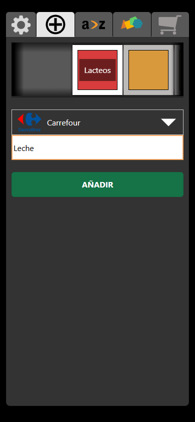
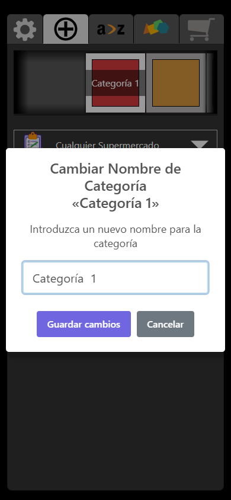
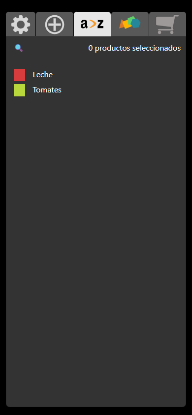
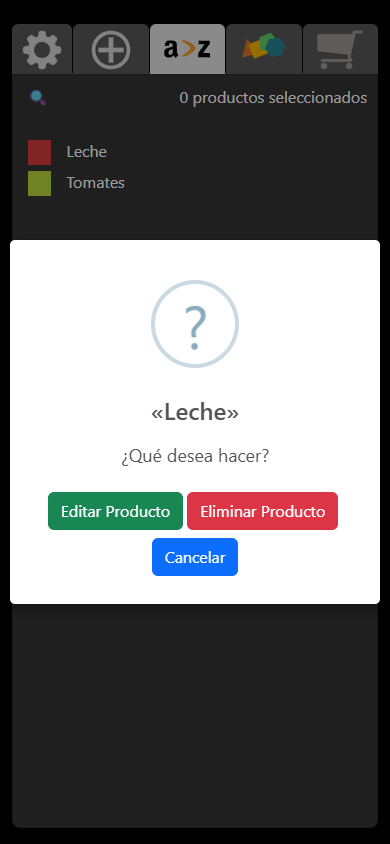
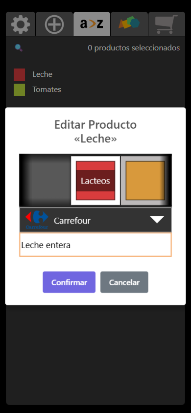
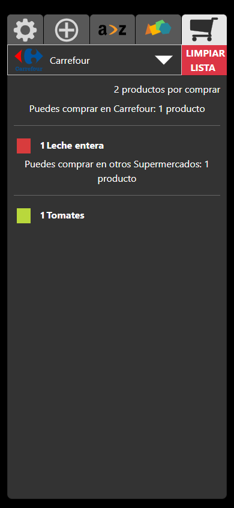
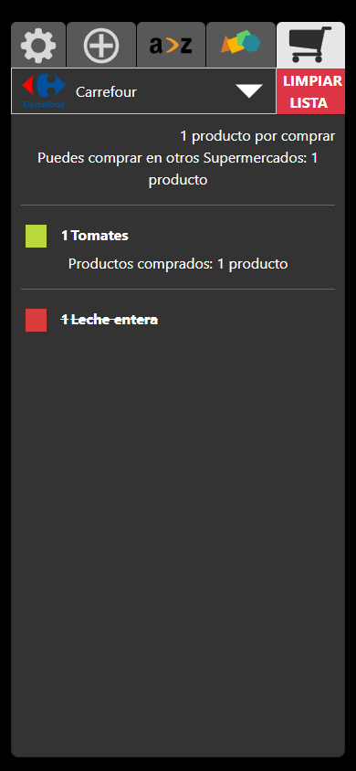
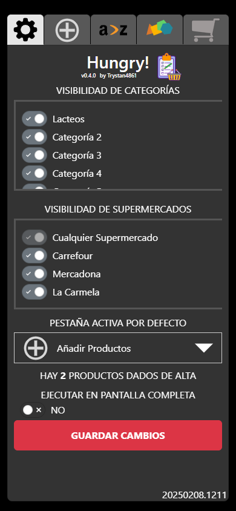
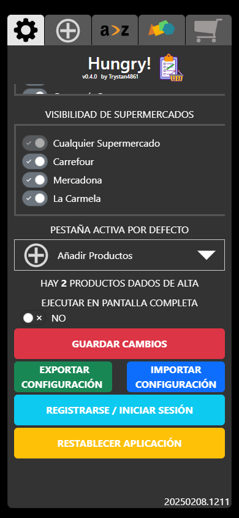

# Guía de uso de `Hungry!`

`Hungry!` permite guardar productos en el navegador, organizarlos por categoría y supermercado y preparar una lista de compra. Esta guía describe los controles disponibles en la aplicación.

Las capturas se tomaron con un viewport móvil de `390 × 844 px`.

## Navegación

La barra superior contiene cinco pestañas, de izquierda a derecha:

| Icono | Sección |
| --- | --- |
| Engranaje | Configuración |
| Símbolo `+` | Añadir productos |
| `a > z` | Productos en orden alfabético |
| Figuras de colores | Productos por categoría |
| Carrito | Lista de la compra |

## Crear un producto

1. Abre la pestaña `+`.
2. En la fila de categorías, toca la categoría a la que pertenecerá el producto. El marco blanco indica la categoría seleccionada. Desliza la fila horizontalmente para ver las demás.
3. En el selector, elige un supermercado. Deja **Cualquier Supermercado** si el producto no pertenece a uno en particular.
4. Escribe el nombre del producto y pulsa **Añadir** o la tecla **Intro**.

Si ya existe un producto con ese nombre, `Hungry!` muestra un aviso y no lo añade. Los cambios se guardan en el almacenamiento local del navegador.

## Renombrar una categoría

En la pestaña `+`, mantén pulsada una categoría visible durante unos **4 segundos**. En el cuadro que aparece, escribe el nuevo nombre y pulsa **Guardar cambios**. Pulsa **Cancelar** para conservar el nombre actual.

La aplicación incluye 20 categorías iniciales. Desde la interfaz se pueden renombrar y mostrar u ocultar, pero no crear ni eliminar categorías ni cambiar sus colores.

## Ver y seleccionar productos

- Usa `a > z` para ordenar los productos por nombre o las figuras de colores para ordenarlos por categoría.
- Pulsa la lupa para buscar por nombre.
- Toca el nombre de un producto para añadirlo a la lista de la compra. En la lista principal, su nombre aparece en negrita y muestra controles para aumentar o reducir la cantidad.
- Para quitarlo de la lista de la compra, toca el cuadrado de color situado a la izquierda del nombre.

## Editar o eliminar un producto

1. En una de las listas principales, mantén pulsado el **nombre del producto durante unos 2 segundos**.
2. Elige **Editar Producto** o **Eliminar Producto**.

Para editarlo, cambia el nombre, la categoría o el supermercado y pulsa **Confirmar**. Pulsa **Cancelar** para descartar los cambios.

Para eliminarlo, confirma la acción en el segundo aviso. La eliminación no se puede deshacer, salvo que tengas una copia exportada. Los productos marcados para la compra no permiten abrir el menú de edición: primero quítalos de la lista tocando su cuadrado de color.

## Usar la lista de la compra

1. En una lista principal, toca el nombre de cada producto que quieras comprar.
2. Abre la pestaña del carrito.
3. Si hay varios supermercados visibles, usa el selector para ver los productos del supermercado elegido. Los de otros supermercados aparecen en un grupo aparte.
4. Cuando compres un producto, tócalo en la lista. Aparecerá tachado bajo **Productos comprados**. Tócalo otra vez para desmarcarlo.

El botón **Limpiar Lista** permite quitar productos de la compra. Si hay productos comprados y pendientes, puedes quitar solo los comprados o todos; si están todos en el mismo estado, se pide confirmación para quitar la lista completa.

## Mostrar u ocultar categorías y supermercados

1. Abre el engranaje de **Configuración**.
2. Activa o desactiva los interruptores de **Visibilidad de Categorías** o **Visibilidad de Supermercados**.
3. Pulsa **Guardar Cambios** para aplicar la selección.

En la pantalla del teléfono, desliza hacia abajo dentro de Configuración para llegar a los botones de importar, exportar, iniciar sesión y restablecer.

- Debe quedar al menos una categoría visible. Los productos de una categoría oculta no aparecen en las listas, pero no se eliminan.
- **Cualquier Supermercado** siempre está disponible y no se puede ocultar. Los productos asignados a supermercados ocultos se conservan; en la lista de la compra se agrupan con los de otros supermercados.
- Renombrar una categoría en la pestaña `+` se guarda al confirmar el cuadro. Los cambios de visibilidad sí requieren **Guardar Cambios**.

## Otras opciones de configuración

- **Pestaña activa por defecto:** elige qué pestaña se abrirá al iniciar `Hungry!`. Después de guardar, confirma la recarga para aplicar el cambio inmediatamente.
- **Ejecutar en pantalla completa:** activa o desactiva el modo de pantalla completa y guarda los cambios.
- **Importar Configuración:** selecciona un archivo JSON de `Hungry!` de hasta 100 KB. Puedes importar toda la configuración o solo productos, categorías y supermercados. La importación completa reemplaza la configuración actual y limpia los datos de inicio de sesión.
- **Exportar Configuración:** descarga `hungry.json` como copia de seguridad. El archivo no incluye credenciales de inicio de sesión.
- **Restablecer Aplicación:** devuelve la aplicación a sus valores iniciales y elimina los cambios y productos actuales. `Hungry!` pregunta si quieres exportar una copia antes de continuar.
- **Registrarse / Iniciar Sesión:** abre las opciones de cuenta, que requieren conexión con el servicio remoto configurado. Los productos y la configuración se guardan localmente en este navegador; para trasladarlos a otro navegador o dispositivo usa Exportar e Importar.

## Dónde se guardan los datos

`Hungry!` guarda productos y configuración en el almacenamiento local del navegador. Los datos pertenecen a ese navegador y dispositivo; borrar los datos del sitio también los elimina. Usa **Exportar Configuración** para conservar una copia.
